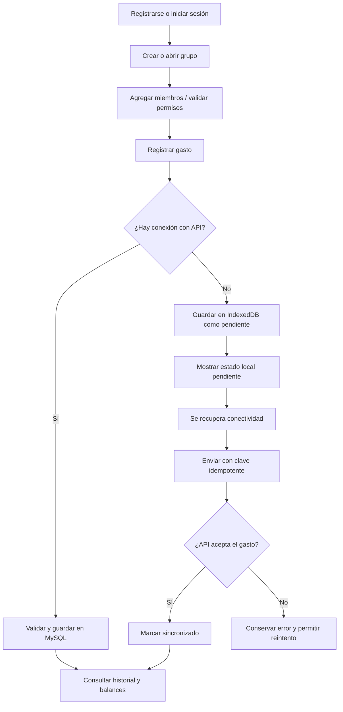
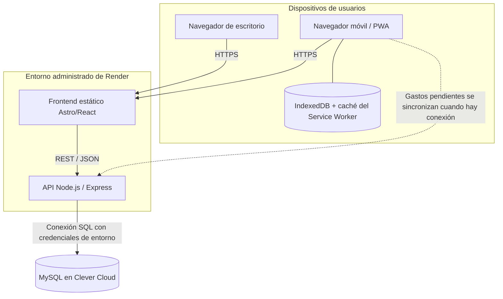
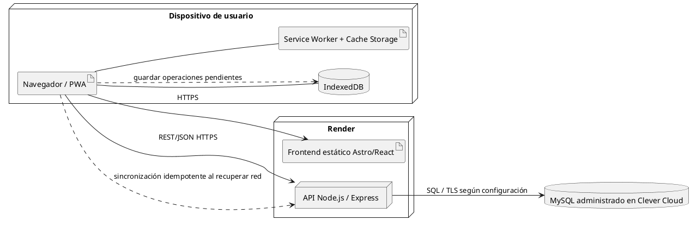
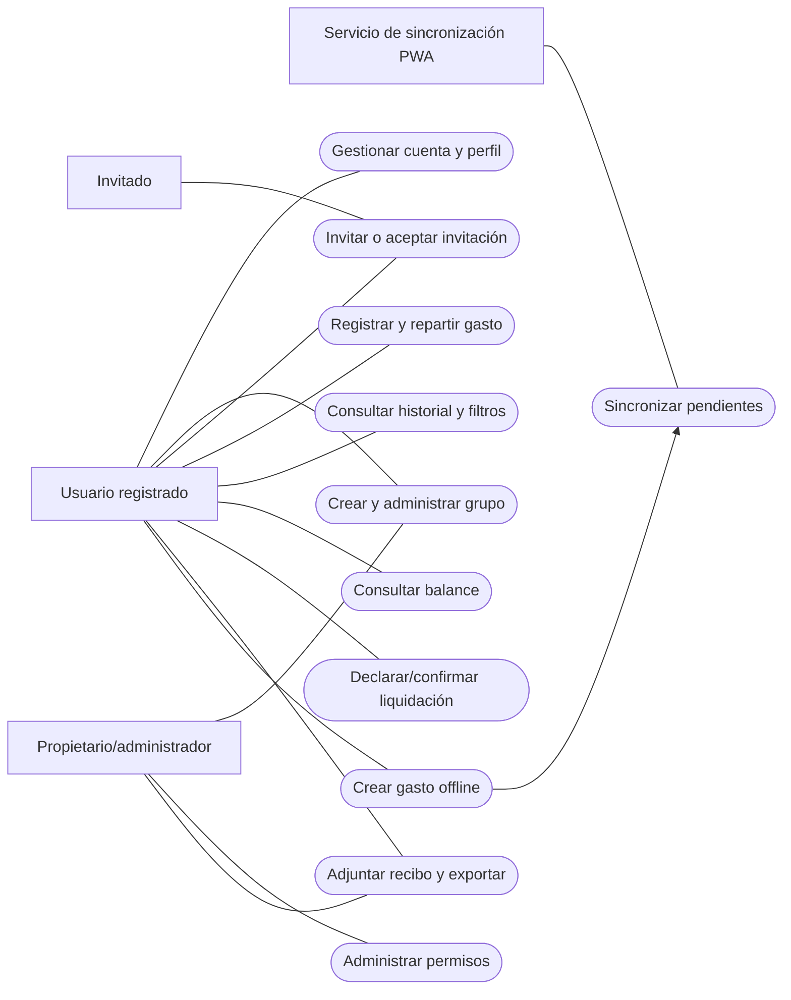
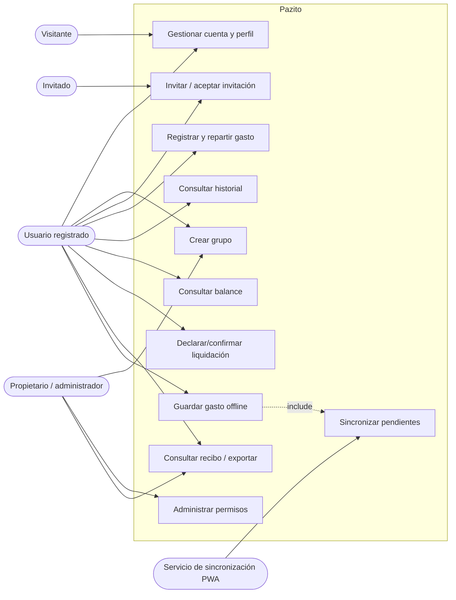
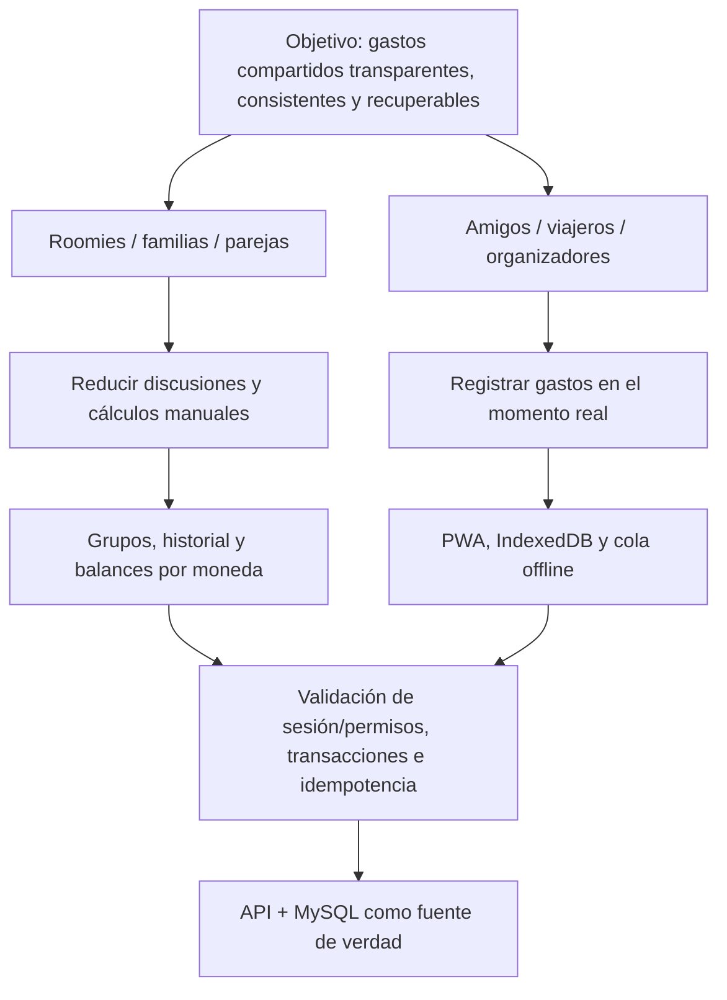

# Manual técnico y documentación académica — Pazito

**Proyecto:** Pazito — aplicación web progresiva para gastos compartidos  
**Asignatura:** Ingeniería de Software  
**Institución:** Institución Universitaria Pascual Bravo  
**Docente:** Claudia María Giraldo Flórez  
**Equipo registrado en la documentación previa:** Jonathan David Botina, Samuel Otálvaro y Jhon Edwin Asprilla  
**Versión documental:** 2.0  
**Fecha:** 24 de octubre de 2026  
**Estado:** documentación de análisis y diseño; las capacidades descritas deben distinguirse de las que han superado pruebas de aceptación.

> **Convención de veracidad.** En este documento se distingue entre (a) decisiones respaldadas por el repositorio o por el historial aportado, (b) requisitos propuestos, (c) valores recomendados que todavía no se han medido y (d) validaciones que siguen pendientes. El hecho de que una función tenga código o que exista una URL pública no demuestra por sí solo que todos sus flujos estén aceptados para producción.

## Tabla de contenido

- [Lista de figuras](#lista-de-figuras)
- [Introducción](#introducción)
1. [Requerimientos del sistema](#1-requerimientos-del-sistema)
   - [1.1 Requerimientos de hardware](#11-requerimientos-de-hardware)
   - [1.2 Requerimientos de software](#12-requerimientos-de-software)
2. [Ficha de proyecto](#2-ficha-de-proyecto)
   - [2.1 Planteamiento del problema](#21-planteamiento-del-problema)
   - [2.2 Objetivo general](#22-objetivo-general)
   - [2.3 Objetivos específicos](#23-objetivos-específicos)
   - [2.4 Alcance del proyecto](#24-alcance-del-proyecto)
3. [Facilitación gráfica y prototipos](#3-facilitación-gráfica-y-prototipos)
4. [Matriz de requisitos](#4-matriz-de-requisitos)
   - [4.1 Requisitos funcionales e información](#41-requisitos-funcionales-e-información)
   - [4.2 Requisitos no funcionales](#42-requisitos-no-funcionales)
5. [Plataforma de desarrollo](#5-plataforma-de-desarrollo)
   - [5.1 Sistema operativo](#51-sistema-operativo)
   - [5.2 Software de desarrollo](#52-software-de-desarrollo)
6. [Diagramas UML — análisis](#6-diagramas-uml--análisis)
   - [6.1 Infraestructura y diagrama de despliegue](#61-infraestructura-y-diagrama-de-despliegue)
   - [6.2 Casos de uso](#62-casos-de-uso)
   - [6.3 Documentación de casos de uso](#63-documentación-de-casos-de-uso)
   - [6.4 Diccionario de actores](#64-diccionario-de-actores)
   - [6.5 Diccionario de casos de uso](#65-diccionario-de-casos-de-uso)
7. [Anexos — análisis de requisitos](#7-anexos--análisis-de-requisitos)
8. [Referentes bibliográficos](#8-referentes-bibliográficos)
9. [Checklist de cobertura de la rúbrica](#9-checklist-de-cobertura-de-la-rúbrica)
10. [Estado de compilación y pruebas reportado](#10-estado-de-compilación-y-pruebas-reportado)

## Lista de figuras

1. Figura 1. Wireframe conceptual de la pantalla principal/resumen.
2. Figura 2. Wireframe conceptual del formulario para registrar gasto en móvil.
3. Figura 3. Wireframe conceptual del historial de gastos.
4. Figura 4. Flujo principal de registro y sincronización offline.
5. Figura 5. Diagrama lógico de despliegue de Pazito.
6. Figura 6. Diagrama de casos de uso.
7. Figura 7. Mapa de impacto.

## Introducción

Este manual reúne los requisitos de Pazito, su ficha de proyecto, prototipos conceptuales, matrices funcionales y no funcionales, plataforma de desarrollo, diagramas de análisis, especificaciones de casos de uso, mapa de impacto, roadmap, historias de usuario, backlog y referentes bibliográficos. Está alineado con la tabla de contenido del documento institucional de evaluación.

El manual describe la arquitectura y la intención funcional, pero no asume que todo el producto esté aceptado. La evidencia de ejecución reportada el 24 de octubre de 2026 muestra que la compilación y las pruebas de API finalizaron correctamente; las pruebas web y el typecheck presentaron errores que se describen en la sección 10. La entrega final deberá actualizar estos resultados después de aplicar las correcciones y volver a ejecutar los comandos.

---

# 1. Requerimientos del sistema

Pazito se desarrolla como aplicación web progresiva (PWA). El usuario interactúa desde un navegador moderno; la interfaz se sirve como sitio estático; las operaciones persistentes se procesan en una API y se almacenan en MySQL. El modo sin conexión depende de que el dispositivo haya cargado previamente los recursos y datos necesarios.

## 1.1. Requerimientos de hardware

Los valores de cliente que aparecen como **recomendación** son una base de planificación, no el resultado de una prueba de carga formal. La aplicación no requiere GPU ni hardware especializado.

| Entorno | Mínimo funcional propuesto | Recomendado | Observaciones |
|---|---|---|---|
| Computador de usuario | Equipo capaz de ejecutar un navegador moderno; conexión a internet para operaciones del servidor | 4 GB de RAM o más, pantalla de 1280 × 720 o superior | La interfaz debe adaptarse al ancho disponible; no se ha realizado una prueba formal de rendimiento por modelo de equipo |
| Teléfono o tableta | Navegador moderno compatible con JavaScript, almacenamiento web e IndexedDB | 3 GB de RAM o más, espacio libre para la caché y la base local del navegador | La instalación PWA y las reglas de almacenamiento dependen del navegador y del sistema operativo |
| Equipo de desarrollo | CPU de 64 bits, 8 GB de RAM como referencia y espacio suficiente para dependencias y builds | 16 GB de RAM, SSD y al menos 10 GB libres para el repositorio, dependencias, builds y herramientas | Valores sugeridos para desarrollo local; deben confirmarse contra el equipo real del estudiante |
| Servidor de aplicación | No se administra hardware físico directamente desde el proyecto | Recursos dimensionados de acuerdo con la concurrencia, tamaño de archivos, consultas y límites del plan | Render administra el entorno de ejecución; las métricas reales deben revisarse en el panel del servicio |
| Base de datos | Servicio MySQL accesible mediante TLS/configuración del proveedor | Conexiones y pool dimensionados conjuntamente para API local, producción y procesos administrativos | Clever Cloud impone límites de conexiones según el servicio/usuario; se debe evitar excederlos |

**Condiciones de uso offline:** el dispositivo debe haber abierto Pazito con conexión, haber descargado el shell de la aplicación y haber cargado los grupos y participantes necesarios. No puede consultarse sin conexión información que nunca se haya almacenado localmente. El navegador puede eliminar almacenamiento local; por ello la cola offline no reemplaza la sincronización temprana ni una copia persistente en servidor.

## 1.2. Requerimientos de software

| Elemento | Uso | Situación conocida |
|---|---|---|
| Sistema operativo de desarrollo | Ejecutar terminal, Git, Bun, navegador y editor | La evidencia entregada muestra Windows en el entorno local. |
| Bun | Instalación de dependencias, scripts, build y pruebas | La ejecución aportada utilizó Bun 1.4.3. |
| Node.js | Runtime de API y herramientas de desarrollo | El servicio de Render ha mostrado Node.js 24.x en logs previos; la versión exacta debe comprobarse en la configuración actual. |
| TypeScript | Tipado estático del frontend, API y contratos compartidos | Configurado en los workspaces del monorepo. |
| Astro y React | Sitio estático, vistas y componentes interactivos | El build entregado generó las rutas de la web con Astro 7.3.8 y React 19.x según los paquetes declarados. |
| Tailwind CSS | Estilos de la interfaz y diseño adaptable | Presente en las dependencias del frontend. |
| Node.js y Express | API REST y lógica de negocio | Backend TypeScript organizado por módulos. |
| MySQL y Drizzle ORM | Persistencia relacional, esquema y acceso a datos | MySQL se usa desde el backend; las migraciones existentes deben aplicarse de manera controlada. |
| IndexedDB | Persistencia local estructurada para grupos cacheados y operaciones offline | Existe una capa de almacenamiento local en el código; su aceptación offline se debe demostrar con pruebas manuales. |
| Service Worker / manifest PWA | Caché de shell y recursos estáticos, instalación donde el navegador lo soporte | El repositorio contiene componentes PWA; deben verificarse actualización e instalación en dispositivos reales. |
| Git y GitHub | Control de versiones, colaboración y fuente para despliegues | Repositorio conocido: `Jhon-Develop/Pazito`. |
| Render | Despliegue del frontend estático y API | Sitio: `https://pazito.onrender.com/`; API: `https://pazito-api.onrender.com/`. Confirmar configuración actual antes de presentar. |
| Clever Cloud | Servicio administrado de MySQL | Las credenciales viven en variables de entorno; no deben escribirse en la documentación ni en Git. |
| Navegador | Ejecución y pruebas funcionales | Chromium/Chrome/Brave se han usado en las capturas de validación; se recomienda probar Safari iOS y Chrome Android además de escritorio. |

## 1.3. Restricciones del sistema

1. Las operaciones definitivas se validan en el servidor, incluidos acceso, permisos, moneda y reparto.
2. IndexedDB puede conservar operaciones pendientes; no concede autorización por sí mismo.
3. La sincronización debe enviar una clave de idempotencia estable para evitar duplicados cuando se reintenta una petición.
4. Los balances oficiales, las liquidaciones y las operaciones que requieren información actualizada del servidor no se deben presentar como actualizados si no existe conexión.
5. El acceso a recibos debe estar protegido y los archivos no deben depender de un filesystem efímero para producción.
6. La configuración de conexiones MySQL debe respetar el máximo agregado de todas las instancias que usan el mismo usuario.

---

# 2. Ficha de proyecto

| Campo | Descripción |
|---|---|
| Nombre | Pazito |
| Tipo | Aplicación web progresiva de gastos compartidos |
| Dominio | Economía cotidiana colaborativa, control de gastos y balances entre personas |
| Problema central | La gestión informal de gastos en grupos causa errores, dudas y trabajo manual al determinar quién pagó, cuánto corresponde a cada persona y qué pagos se confirmaron. |
| Usuarios destinatarios | Compañeros de vivienda, parejas, familias, grupos de amigos, viajeros y organizadores de actividades. |
| Propuesta de valor | Registro único y compartido; cálculo determinista del reparto; balances trazables; acceso multidispositivo y captura offline limitada. |
| Modelo de acceso | Usuarios registrados, grupos e invitaciones; permisos definidos en backend. |
| Tecnologías principales | Astro, React, TypeScript, Tailwind CSS, Node.js, Express, MySQL, Drizzle ORM, IndexedDB y PWA. |
| Repositorio | `https://github.com/Jhon-Develop/Pazito` |
| Web publicada | `https://pazito.onrender.com/` |
| API publicada | `https://pazito-api.onrender.com/` |
| Base de datos | MySQL gestionado en Clever Cloud; URL de conexión confidencial. |
| Método de trabajo | Desarrollo incremental y organización retrospectiva mediante backlog, épicas, historias, tareas y criterios de aceptación. |

## 2.1. Planteamiento del problema

Cuando varias personas comparten gastos, la información suele dispersarse entre conversaciones, recibos, notas y hojas de cálculo. Cada persona puede tener una interpretación diferente del importe, de las personas que deben participar o de si un pago ya fue realizado. La situación se complica con numerosos movimientos, reglas de reparto diferentes, grupos de larga duración y monedas distintas.

Los errores no son solamente visuales: una cifra que un dispositivo interpreta en unidades menores y otro presenta como si fueran pesos puede cambiar un importe por un factor de cien. También puede perderse un registro cuando se crea durante un viaje sin conectividad. La aplicación debe definir una convención monetaria común, validar los datos en el servidor y utilizar una cola offline con sincronización idempotente.

Pazito busca centralizar el historial compartido y derivar los balances de los gastos, las participaciones y las liquidaciones confirmadas. No mueve dinero ni sustituye la confirmación de las personas que participan en un pago.

## 2.2. Objetivo general

Desarrollar y documentar una aplicación web progresiva que permita a grupos de personas registrar, repartir y consultar gastos compartidos de manera consistente y segura desde dispositivos de escritorio y móviles, incorporando almacenamiento local de gastos previamente preparados y sincronización controlada cuando se recupere la conectividad.

## 2.3. Objetivos específicos

1. Implementar registro de usuarios, inicio y cierre de sesión y mantenimiento del perfil.
2. Permitir crear grupos, gestionar miembros e invitaciones y aplicar permisos por rol desde el backend.
3. Permitir registrar, editar, consultar y archivar gastos con pagador, fecha, moneda, categoría y participantes.
4. Implementar repartos equitativos, por montos y por porcentajes que preserven exactamente la suma de unidades monetarias.
5. Calcular balances a partir de movimientos persistidos y distinguir pagos declarados, confirmados, disputados y cancelados.
6. Mantener una presentación monetaria coherente en distintos navegadores, dispositivos y participantes del mismo grupo.
7. Permitir instalar la PWA en navegadores compatibles y guardar gastos nuevos en IndexedDB para grupos ya cargados.
8. Sincronizar las operaciones pendientes al recuperar conexión usando idempotencia y validando nuevamente los permisos.
9. Proteger los datos mediante validación en servidor, sesiones seguras, registro de auditoría y tratamiento cuidadoso de secretos.
10. Documentar arquitectura, requisitos, casos de uso, despliegue, pruebas y backlog para facilitar mantenimiento y evaluación académica.

## 2.4. Alcance del proyecto

### Incluido en el alcance funcional

- Registro, inicio/cierre de sesión y recuperación de contraseña, sujeta a que el transporte de correo esté configurado.
- Perfil de usuario con nombre visible, URL de avatar y preferencias regionales.
- Grupos, roles, permisos e invitaciones con expiración.
- Gastos, pagador, participantes, categorías, descripción, fecha y moneda.
- Reparto equitativo, por cantidades y por porcentajes.
- Conversión monetaria con tasa de referencia almacenada para el gasto.
- Balances por grupo y liquidaciones manuales con estados y trazabilidad.
- Historial, filtros, comprobantes y exportaciones según los flujos habilitados y sus permisos.
- PWA con shell cacheado y una vía de captura offline de gastos previamente preparados.
- API REST documentada en OpenAPI, persistencia MySQL, logs estructurados y health checks.

### Fuera del alcance del MVP

- Ejecutar transferencias o custodiar fondos.
- Asegurar la disponibilidad sin conexión de toda la aplicación y todos sus módulos.
- Calcular balances oficiales desconectados del servidor como si estuvieran actualizados.
- Autorizar offline invitaciones, cambios de permisos, liquidaciones o acciones financieras críticas.
- Garantizar la conservación de datos locales si el usuario borra el almacenamiento del navegador o el sistema operativo lo elimina.
- Considerar demostrada la aceptación de producción sin probar los flujos E2E y la sincronización real.

### Entregables

1. Repositorio monorepo con aplicaciones web y API, y paquete de contratos compartidos.
2. Base de datos MySQL y migraciones versionadas.
3. Web PWA y API desplegadas en proveedores administrados.
4. Pruebas unitarias y de integración existentes.
5. Documento de requisitos, diseño, casos de uso, arquitectura, pruebas y operación.
6. Backlog Scrum y checklist de aceptación.

---

# 3. Facilitación gráfica y prototipos

Esta sección incluye esquemas de baja fidelidad que representan la jerarquía y el flujo esperado. Los bloques son **wireframes conceptuales**, no capturas pixel-perfect ni prueba de que cada detalle visual se encuentre desplegado.

## 3.1. Prototipo: pantalla principal/resumen

```text
┌──────────────────────────────────────────────────────────────┐
│ Pazito                          [Avatar] [Perfil] [Salir]    │
├──────────────┬───────────────────────────────────────────────┤
│ Resumen      │ Hola, usuario                                 │
│ Grupos       │ [Crear grupo] [Registrar gasto]               │
│ Gastos       │                                               │
│ Balances     │ [Grupos activos] [Gastos recientes]           │
│ Liquidaciones│ [Saldos por moneda]                           │
│ Configuración│                                               │
│              │ Tus grupos          Actividad reciente        │
│              │ [Grupo A]           [Gasto 1]                 │
│              │ [Grupo B]           [Gasto 2]                 │
└──────────────┴───────────────────────────────────────────────┘
```

**Figura 1.** Wireframe conceptual de la pantalla principal/resumen.

## 3.2. Prototipo: registrar gasto en móvil

```text
┌──────────────────────────────┐
│ ☰ Nuevo gasto      [Perfil] │
├──────────────────────────────┤
│ Grupo                        │
│ [Seleccionar grupo        ▾] │
│ Título                       │
│ [Mercado                  ]  │
│ Importe                      │
│ [$ 200.000                 ] │
│ Moneda                       │
│ [COP                      ▾] │
│ Pagó                         │
│ [Yo                       ▾] │
│ Participantes                │
│ [✓ Ana] [✓ Juan] [✓ Yo]     │
│ Tipo de reparto              │
│ [Equitativo               ▾] │
│ [Guardar gasto]              │
│                              │
│ Estado: sincronizado /       │
│ pendiente offline            │
└──────────────────────────────┘
```

**Figura 2.** Wireframe conceptual del formulario para registrar un gasto desde móvil.

**Criterio de diseño monetario:** los campos de importe muestran pesos legibles y el cliente convierte a la unidad menor de almacenamiento al guardar. La etiqueta de estado distingue una operación confirmada por API de una operación que sigue en cola local.

## 3.3. Prototipo: lista de gastos

```text
┌──────────────────────────────────────────────────────────────┐
│ Gastos                                                       │
│ Buscar [____________] Grupo [Todos ▾] Categoría [Todas ▾]    │
│ Desde [____] Hasta [____]            [Limpiar] [Aplicar]     │
├──────────────────────────────────────────────────────────────┤
│ [Icono] Mercado        Comida · Pendiente          $ 200.000 │
│         Pagó Ana · reparto equitativo                        │
│         [Participaciones y recibos] [Editar] [Archivar]      │
├──────────────────────────────────────────────────────────────┤
│ [Icono] Transporte     Viajes · Sincronizado       $ 35.000  │
│         Pagó Juan · reparto por porcentajes                  │
└──────────────────────────────────────────────────────────────┘
```

**Figura 3.** Wireframe conceptual del historial de gastos y filtros.

## 3.4. Flujo principal de usuario



**Figura 4.** Flujo principal de registro y sincronización offline.

## 3.5. Prototipos finales pendientes de evidencia visual

Para la entrega académica es recomendable incorporar capturas propias de la versión aceptada: pantalla de resumen en escritorio, pantalla de gastos en móvil, creación de grupo, formulario de gasto, visualización del balance e indicador offline. Las capturas deben identificar la figura, el dispositivo/navegador y la versión desplegada. Las imágenes aportadas en conversaciones anteriores demuestran que existen vistas de gastos, pero no demuestran por sí solas que toda la aplicación haya pasado pruebas de aceptación.

---

# 4. Matriz de requisitos

Convenciones de prioridad: **P1** = crítica para el flujo principal o la integridad; **P2** = importante para completar el producto; **P3** = mejora o soporte. El estado indica el conocimiento disponible y no debe confundirse con aceptación formal.

## 4.1. Requisitos funcionales e información

| ID | Requisito funcional | Información principal | Criterio de aceptación verificable | Prioridad | Estado de referencia |
|---|---|---|---|---|---|
| RF-01 | Registrar usuario | Nombre, correo, hash de contraseña, estado | Una cuenta válida se registra; una duplicada se rechaza sin exponer secretos | P1 | Implementado en código; validar flujo end-to-end |
| RF-02 | Iniciar/cerrar sesión | Usuario, sesión, token/hash, expiración | Login crea sesión utilizable; logout invalida sesión; token no se persiste en texto plano en Local Storage | P1 | Implementado en código; prueba de cookies y sesiones pendiente |
| RF-03 | Recuperar contraseña | Token de recuperación, caducidad, usuario | Un token válido y no expirado permite restablecer una vez; no se revela si correo existe | P2 | Requiere probar la configuración de correo real |
| RF-04 | Mantener perfil | Nombre visible, avatar URL, idioma, zona horaria | El usuario edita sus propios datos y ve el avatar actualizado en las vistas que lo usan | P2 | Implementado en código; revisar cobertura del avatar |
| RF-05 | Crear grupo | Nombre, descripción, moneda, dueño | Usuario autenticado crea el grupo y queda como dueño/miembro; falla limpiamente si API no está disponible | P1 | El defecto de `joined_at` fue corregido en local; confirmar commit/despliegue |
| RF-06 | Gestionar miembros y roles | Grupo, usuario, rol y estado de membresía | Solo un usuario con permiso puede cambiar roles o miembros; se rechazan accesos ajenos | P1 | Implementado en código; pruebas negativas de autorización pendientes |
| RF-07 | Invitar miembros | Token/hash, expiración, usos, grupo | Invitación válida incorpora al destinatario autorizado; las vencidas o agotadas se rechazan | P2 | Implementado en código; validar con dos cuentas reales |
| RF-08 | Crear gasto | Grupo, título, descripción, categoría, importe, moneda, fecha, pagador | Un gasto válido se guarda una vez con todos los campos autorizados y aparece en historial | P1 | Implementado en código; aceptación multiplataforma pendiente |
| RF-09 | Dividir importe | Regla, participantes, montos/porcentajes, residuo | La suma de participaciones coincide exactamente con el importe total en unidades menores | P1 | Pruebas API de dominio existen; ampliar regresión web |
| RF-10 | Editar/archivar gasto | Gasto, autor, permisos, estado | Solo roles autorizados pueden modificar; archivar conserva trazabilidad requerida | P2 | Implementado en código; probar en producción controlada |
| RF-11 | Mostrar moneda | Código ISO, `amountMinor`, locale | Un mismo valor se muestra idénticamente en móvil/escritorio con misma versión; COP se presenta sin centavos aunque el storage usa escala 2 | P1 | Se identificaron 5 fallos en tests web monetarios; corregir y volver a ejecutar |
| RF-12 | Convertir moneda | Importe original, moneda origen/destino, tasa y fuente | El gasto conserva importe original y datos de conversión usados para que el cálculo sea explicable | P2 | Implementado en código; validar respuestas de proveedor FX |
| RF-13 | Consultar balance | Gastos, participaciones, liquidaciones confirmadas | El balance se calcula sin mezclar monedas; el neto de un grupo queda en cero dentro de cada moneda según el modelo | P1 | Pruebas unitarias de balance existen; prueba integral pendiente |
| RF-14 | Registrar liquidación manual | Pagador, receptor, cantidad, estado, eventos | Un pago declarado no modifica balance oficial hasta confirmarse; la disputa conserva evidencia | P2 | Implementado en código; validar flujo entre dos miembros |
| RF-15 | Filtrar y consultar gastos | Texto, grupo, categoría y periodo | Los filtros limitan resultados a los recursos permitidos al usuario | P2 | Implementado en UI; pruebas E2E por filtros pendientes |
| RF-16 | Adjuntar recibos | Archivo, metadatos, gasto, permisos | Archivo permitido se vincula al gasto y solo usuarios autorizados pueden consultarlo | P2 | Revisar almacenamiento persistente antes de producción |
| RF-17 | Exportar informe | Usuario/grupo, periodo, datos exportados | CSV/PDF contiene los datos autorizados con importes correctos y sin incluir otros grupos | P2 | Implementado en código; verificación de privacidad pendiente |
| RF-18 | Guardar gasto offline | ID local, grupo cacheado, datos de gasto, clave idempotente, estado | Sin conexión, un gasto válido se conserva en IndexedDB y se identifica como pendiente | P1 | La ruta offline existe parcialmente; debe probarse en móvil real |
| RF-19 | Sincronizar pendientes | Cola local, usuario, clave idempotente, respuesta API | Al recuperar conexión, se reintenta sin crear duplicados y el backend vuelve a validar permisos | P1 | Implementado parcialmente; prueba de desconexión y reconexión pendiente |
| RF-20 | Instalar/actualizar PWA | Manifest, service worker, HTML, assets versionados | La app se instala en navegadores compatibles y se activa una versión nueva del shell sin dejar bundles incompatibles | P2 | Código PWA existente; instalación/actualización real pendiente |
| RF-21 | Auditar acciones críticas | Actor, acción, recurso, fecha, request ID | Se registra el evento requerido sin guardar tokens, contraseñas ni cadenas SQL con datos sensibles | P1 | Infraestructura presente; revisión de logs y retención pendiente |
| RF-22 | Consultar salud del servicio | Estado API y conexión de DB | Liveness informa proceso activo; readiness verifica dependencias necesarias | P2 | Endpoints presentes; API readiness respondió `ready/database ok` en prueba previa |

### Datos y entidades de información

| Entidad | Atributos conceptuales | Relaciones principales |
|---|---|---|
| Usuario | `id`, nombre, correo, hash de contraseña, avatar, locale, timezone, estado | Pertenece a grupos, crea gastos, participa y abre sesiones |
| Sesión | id/hash de token, userId, fecha de expiración y revocación | Pertenece a un usuario; se invalida al cerrar sesión o vencer |
| Grupo | id, nombre, descripción, moneda, dueño, estado, fechas | Tiene miembros, invitaciones, gastos y liquidaciones |
| Miembro de grupo | groupId, userId, rol, estado, fecha de ingreso/salida | Relaciona usuarios y grupos; su permiso se valida por operación |
| Invitación | grupo, token/hash, expiración, límite de usos, estado | Es creada por un actor autorizado y aceptada por un usuario |
| Gasto | grupo, título, descripción, importe original, moneda, pagador, fechas, estado | Tiene participaciones, adjuntos y eventos |
| Participación | gasto, miembro, importe asignado, regla | Sus importes deben sumar el importe del gasto en la escala acordada |
| Tasa FX aplicada | monedas, tasa, fuente, fecha | Explica la conversión del gasto a moneda de liquidación |
| Liquidación | grupo, deudor, acreedor, importe, estado y fechas | Sus eventos registran declaración, confirmación, disputa o cancelación |
| Recibo | gasto, ubicación de almacenamiento, tipo, tamaño y metadatos | Solo se sirve a usuarios autorizados |
| Clave de idempotencia | clave, usuario, endpoint, estado y respuesta | Identifica un reintento lógico y evita operaciones duplicadas |
| Evento de auditoría | actor, acción, recurso, timestamp y metadatos permitidos | Proporciona trazabilidad de operaciones críticas |
| Gasto offline | id local, payload permitido, grupo, propietario, estado sync, idempotencia | Vive en IndexedDB hasta ser aceptado o marcado con error de sincronización |

## 4.2. Requisitos no funcionales

| ID | Categoría | Requisito | Criterio de aceptación | Prioridad |
|---|---|---|---|---|
| RNF-01 | Seguridad | Las operaciones protegidas requieren sesión válida y autorización por recurso | Las pruebas negativas reciben `401/403`; cambiar un ID no permite leer o escribir recursos ajenos | P1 |
| RNF-02 | Privacidad | No registrar tokens, contraseñas ni secretos en logs o repositorio | Revisión estática de logs/configuración sin secretos reales | P1 |
| RNF-03 | Integridad monetaria | Usar enteros/unidades menores, `bigint` en backend y reglas de redondeo deterministas | Casos de reparto suman exactamente el importe, incluidos residuos positivos/negativos | P1 |
| RNF-04 | Consistencia entre clientes | Igual payload/moneda debe dar la misma cantidad visible en todos los dispositivos | Prueba de regresión móvil-escritorio para COP, USD, EUR y monedas con 0/3 decimales | P1 |
| RNF-05 | Offline | La captura local no se presenta como confirmación del servidor | Indicador pendiente; recuperación tras cerrar/reabrir la PWA; errores de sincronización visibles | P1 |
| RNF-06 | Idempotencia | Reintentos con la misma clave no duplican el gasto | Dos envíos con la misma clave generan un solo movimiento lógico | P1 |
| RNF-07 | Disponibilidad | Health checks separan liveness y readiness | Liveness comprueba proceso; readiness comprueba dependencias necesarias | P2 |
| RNF-08 | Rendimiento | Listados se paginan y pool respeta límites MySQL | No se exceden conexiones configuradas en pruebas controladas; se miden tiempos antes de optimizar | P2 |
| RNF-09 | Compatibilidad | Diseño adaptable y PWA para navegadores actuales compatibles | Flujos esenciales verificados en desktop Chromium, Android y Safari iOS cuando esté disponible | P2 |
| RNF-10 | Mantenibilidad | TypeScript, contratos compartidos, módulos por dominio y migraciones versionadas | `build`, `typecheck`, pruebas y revisión de migraciones documentados en cada release | P1 |
| RNF-11 | Recuperación | Operaciones offline pendientes sobreviven a reapertura dentro de las políticas del navegador | Prueba sin red, cierre/reapertura y sincronización posterior; informar límites de almacenamiento | P1 |
| RNF-12 | Trazabilidad | Errores se correlacionan mediante `requestId` | Un fallo se localiza en log de API sin exponer datos secretos | P2 |
| RNF-13 | Accesibilidad básica | Controles con labels, foco visible y nombres accesibles | Auditoría manual de formularios y navegación por teclado | P2 |
| RNF-14 | Persistencia de archivos | Recibos no dependen de disco efímero del servidor | Validar almacenamiento privado persistente y autorización antes del uso de producción | P1 |

---

# 5. Plataforma de desarrollo

## 5.1. Sistema operativo

### Desarrollo local

La evidencia de los comandos y capturas muestra desarrollo en Windows mediante PowerShell. El entorno ejecuta Bun, Node.js, el frontend Astro y la API Node/Express. El navegador utilizado en las pruebas visuales ha sido Chromium/Brave.

### Entorno publicado

La aplicación web se publica como sitio estático en Render y la API como servicio web. El proyecto no administra un sistema operativo de servidor directamente; el proveedor administra el runtime y el contenedor/entorno de servicio. La versión y configuración exactas deben comprobarse en los paneles de Render antes de escribirlas en una entrega final.

### Dispositivos finales

Pazito debe poder abrirse desde navegadores modernos en escritorio y móvil. Para la instalación PWA se debe validar la compatibilidad del navegador y sus reglas de almacenamiento, permisos y service worker. La interfaz no debe asumir ancho de escritorio para crear un gasto.

## 5.2. Software de desarrollo

| Herramienta/tecnología | Responsabilidad | Evidencia/configuración |
|---|---|---|
| Git + GitHub | Control de versiones, commits, ramas y origen de despliegue | Repo `Jhon-Develop/Pazito` |
| Bun | Workspaces, dependencias, scripts de desarrollo, build y test | Comandos usados: `bun install`, `bun run dev`, `bun run build`, `bun run test:web`, `bun run test:api`, `bun run typecheck` |
| TypeScript | Tipado y compilación del código | Paquetes `apps/web`, `apps/api` y `packages/contracts` |
| Astro | Build y publicación estática de rutas web | `apps/web` genera `apps/web/dist` |
| React | Componentes y páginas interactivas | Componentes dentro de `apps/web/src` |
| Tailwind CSS | Sistema de estilos responsive | Dependencia de frontend |
| Node.js + Express | API REST | Entrada principal `apps/api/src/server.ts` y configuración en `apps/api/src/app.ts` |
| Zod | Validación estructural de entradas y contratos | Presente en paquetes web/API/contratos |
| Drizzle ORM / drizzle-kit | Mapeo de tablas y migraciones | Esquema `apps/api/src/infrastructure/database/schema.ts`; configuración y migraciones en `apps/api/database` |
| MySQL | Persistencia relacional | Clever Cloud; no compartir `DATABASE_URL` |
| IndexedDB (idb) | Cola local y datos cacheados | Capa `apps/web/src/lib/offline` |
| Vitest | Pruebas unitarias y de integración | Scripts de `apps/web` y `apps/api` |
| OpenAPI | Contrato documentado de la API | `/api/v1/openapi.json` y documentación del backend |
| Render | Web estática y API desplegadas | Variables configuradas en dashboard; despliegue conectado al repositorio |
| Clever Cloud | MySQL administrado | Base `pazito_dev` creada para pruebas según evidencia del usuario; no ejecutar migraciones sin revisar el entorno |

### Comandos de verificación

```powershell
bun install
bun run build
bun run test:web
bun run test:api
bun run typecheck
bun run lint:api
bun run openapi:check
```

Los comandos deben ejecutarse en la raíz del monorepo. `bun run build` verifica compilación y construcción, pero no sustituye las pruebas. `test:web`, `test:api` y `typecheck` son puertas separadas y sus resultados deben registrarse de forma independiente.

---

# 6. Diagramas UML — análisis

## 6.1. Infraestructura y diagrama de despliegue

El siguiente esquema se presenta en Mermaid para su visualización directa en lectores compatibles. El bloque PlantUML posterior ofrece una representación más cercana a un diagrama UML de despliegue si el evaluador requiere ese formato.





**Figura 5.** Diagrama lógico de despliegue de Pazito.

**Descripción de despliegue.** El usuario accede al sitio estático servido por Render. El cliente envía solicitudes HTTP/JSON a la API. La API valida sesión, permisos y datos antes de consultar o modificar MySQL. El dispositivo móvil conserva un subconjunto de datos y gastos pendientes en IndexedDB, mientras el service worker almacena recursos estáticos; la caché de recursos no es la base de datos de negocio. La clave de idempotencia evita duplicados cuando el cliente reintenta una operación. Las credenciales de MySQL se configuran en variables de entorno y no se incluyen en el frontend.

## 6.2. Casos de uso

### Diagrama general

El diagrama Mermaid es una vista legible en GitHub; el diagrama PlantUML permite exportar un diagrama de casos de uso con notación UML si se entrega en PDF/imagen.


----------


**Figura 6.** Diagrama de casos de uso de Pazito.

### Actores y objetivos principales

- Usuario registrado: administra su perfil y participa en grupos y movimientos permitidos.
- Propietario/administrador: gestiona miembros, configuración y permisos del grupo.
- Invitado: utiliza una invitación válida para incorporarse al grupo, después de cumplir las condiciones de registro/autenticación.
- Servicio de sincronización PWA: reintenta operaciones que ya fueron guardadas localmente; no sustituye al usuario como autoridad de permisos ni ejecuta acciones sin validar la sesión actual.

## 6.3. Documentación de casos de uso

### CU-01 — Registrar usuario e iniciar sesión

| Campo | Descripción |
|---|---|
| Actor principal | Visitante / usuario |
| Objetivo | Obtener una cuenta y una sesión válida para acceder a recursos protegidos. |
| Precondiciones | El visitante tiene un correo y contraseña válidos; la API y la base de datos están disponibles. |
| Disparador | El visitante envía el formulario de registro o login. |
| Flujo principal | 1. El usuario completa el formulario. 2. El frontend valida datos básicos. 3. La API valida y procesa la solicitud. 4. Se crea o valida la cuenta. 5. Se establece la sesión. 6. Se muestra el área autenticada. |
| Alternativas / errores | Correo duplicado, credenciales inválidas, servicio caído o límite de conexiones; el sistema presenta un error sin revelar secretos. |
| Postcondición | Existe una sesión válida o el usuario recibe un error controlado. |
| Criterios | El token no se expone en Local Storage; las rutas protegidas exigen autenticación; logout invalida la sesión. |

### CU-02 — Crear grupo

| Campo | Descripción |
|---|---|
| Actor principal | Usuario autenticado |
| Objetivo | Crear un espacio de gastos compartidos con moneda base. |
| Precondiciones | Hay sesión válida y conexión a API. |
| Disparador | El usuario envía el formulario de nuevo grupo. |
| Flujo principal | 1. Introduce nombre, descripción y moneda. 2. Cliente envía `POST /api/v1/groups` con clave de idempotencia. 3. API valida la sesión y entrada. 4. Backend registra el grupo, propietario/miembro y permisos iniciales en una transacción. 5. Se devuelve el grupo creado y se actualiza la UI. |
| Alternativas / errores | Entrada no válida, falta de permiso, reintento idempotente o error SQL. La transacción debe revertirse ante fallos. |
| Postcondición | El grupo queda guardado una sola vez y el creador tiene el rol correspondiente. |
| Criterios | El grupo aparece en listado; su moneda se conserva; no se crean filas parciales tras un fallo. |

### CU-03 — Invitar miembro

| Campo | Descripción |
|---|---|
| Actor principal | Propietario/administrador o miembro con permiso |
| Objetivo | Facilitar que otra persona se incorpore a un grupo. |
| Precondiciones | Sesión válida, pertenencia al grupo y permiso para invitar. |
| Flujo principal | 1. El actor solicita invitación. 2. API genera una invitación limitada. 3. UI presenta enlace/QR. 4. El destinatario abre el enlace e inicia sesión/registro. 5. API comprueba expiración y usos. 6. La membresía se registra. |
| Alternativas / errores | Invitación expirada, agotada o revocada; permisos insuficientes; el servidor rechaza sin alterar membresías. |
| Postcondición | Destinatario autorizado se convierte en miembro. |
| Criterios | El token de invitación es impredecible, caduca y no otorga acceso a otros grupos. |

### CU-04 — Registrar y repartir gasto en línea

| Campo | Descripción |
|---|---|
| Actor principal | Miembro con permiso de registro |
| Objetivo | Registrar gasto y asignar la parte de cada persona. |
| Precondiciones | Sesión, grupo y miembros autorizados disponibles en servidor. |
| Flujo principal | 1. Elige grupo, moneda, importe, pagador, participantes, regla y descripción. 2. UI convierte el importe visible a unidades menores según exponente definido. 3. Envía payload con clave idempotente. 4. API valida permiso, importe y reparto. 5. Persiste gasto y participaciones en transacción. 6. La UI muestra el gasto confirmado. |
| Alternativas / errores | Si API está inaccesible, se deriva al flujo offline solo si cumple sus condiciones; si validación falla, no se marca como confirmado. |
| Postcondición | El gasto persistido y la suma de participaciones coinciden exactamente. |
| Criterios | Una entrada `200000` COP debe convertirse a la unidad interna definida y mostrarse como `$ 200.000` en todos los clientes. |

### CU-05 — Crear gasto sin conexión

| Campo | Descripción |
|---|---|
| Actor principal | Usuario autenticado anteriormente en el mismo dispositivo |
| Objetivo | No perder el registro de un gasto cuando la red no está disponible. |
| Precondiciones | PWA instalada/cargada, usuario local recuperable, grupo y participantes previamente almacenados. |
| Flujo principal | 1. Usuario completa gasto. 2. Cliente detecta que la API no está disponible o devuelve el estado offline definido. 3. Valida localmente los campos. 4. Guarda gasto y clave idempotente en IndexedDB. 5. Muestra “pendiente de sincronizar”. |
| Alternativas / errores | Si no existe grupo cacheado o IndexedDB falla, no se promete persistencia y se informa el error. |
| Postcondición | El gasto pendiente persiste en el dispositivo dentro de los límites del navegador. |
| Criterios | Al cerrar/reabrir la PWA en el mismo dispositivo el gasto pendiente sigue visible; no figura como confirmado por servidor. |

### CU-06 — Sincronizar gastos pendientes

| Campo | Descripción |
|---|---|
| Actor principal | Servicio de sincronización de la PWA actuando en sesión del usuario |
| Objetivo | Enviar operaciones locales cuando vuelve la conexión. |
| Precondiciones | Hay conexión, sesión válida y operaciones pendientes con clave idempotente. |
| Flujo principal | 1. La PWA detecta conectividad/restablecimiento o usuario activa sincronización. 2. Lee cola pendiente. 3. Envía operación con misma clave idempotente. 4. API valida usuario, membresía y payload. 5. API crea o devuelve resultado idempotente. 6. Cliente marca sincronizado y actualiza datos cacheados. |
| Alternativas / errores | Timeout conserva pendiente; permiso revocado produce error visible; respuesta duplicada idempotente no crea un segundo gasto. |
| Postcondición | Cada operación aceptada se sincroniza una vez; las rechazadas permanecen identificables para resolverlas. |
| Criterios | La prueba debe alternar sin conexión/con conexión y verificar una sola fila de gasto. |

### CU-07 — Consultar historial y filtrar

| Campo | Descripción |
|---|---|
| Actor principal | Miembro autorizado |
| Objetivo | Encontrar gastos relevantes dentro de grupos accesibles. |
| Precondiciones | Sesión válida; para resultados recientes se requiere servidor, salvo datos explícitamente cacheados. |
| Flujo principal | 1. Selecciona filtros. 2. API devuelve página de resultados autorizados. 3. UI muestra importes, estado, fecha y detalles. |
| Alternativas / errores | Si falla conexión y hay datos cacheados, se muestran como información local/no actualizada. |
| Postcondición | Usuario obtiene una lista consistente con filtros aplicados. |
| Criterios | No se incluyen gastos de grupos a los que el usuario no tiene acceso. |

### CU-08 — Consultar balance

| Campo | Descripción |
|---|---|
| Actor principal | Miembro autorizado |
| Objetivo | Conocer saldos por moneda y grupos. |
| Precondiciones | Acceso al grupo y respuesta actual de API. |
| Flujo principal | 1. UI solicita balance. 2. API calcula gastos, participaciones y liquidaciones confirmadas. 3. Se devuelven balances por moneda. 4. UI separa lo que el usuario debe de lo que le deben. |
| Alternativas / errores | Offline: no se presentan cálculos oficiales como actuales; se informa que se necesita conexión. |
| Postcondición | Balance se deriva de los registros aceptados. |
| Criterios | No se mezclan monedas distintas y los saldos netos de cada moneda cumplen la regla de conservación del modelo. |

### CU-09 — Declarar y confirmar liquidación

| Campo | Descripción |
|---|---|
| Actor principal | Deudor; para confirmar, acreedor/actor permitido |
| Objetivo | Registrar que un saldo se pagó y guardar confirmación. |
| Precondiciones | Grupo y saldo disponibles; sesión válida. |
| Flujo principal | 1. Deudor declara el pago. 2. El pago pasa a estado pendiente/declarado. 3. Acreedor confirma, disputa o actor permitido cancela. 4. Se añade evento de historial. 5. Balance oficial se ajusta solo según estados admitidos. |
| Alternativas / errores | Estado inválido, actor no autorizado o intento de confirmar dos veces; API rechaza acción. |
| Postcondición | La liquidación tiene un estado trazable. |
| Criterios | Una liquidación declarada pero no confirmada no reduce el saldo oficial. |

### CU-10 — Exportar o consultar recibo

| Campo | Descripción |
|---|---|
| Actor principal | Usuario autorizado del grupo |
| Objetivo | Conservar evidencia o descargar el informe. |
| Precondiciones | Sesión válida y permisos sobre gasto/grupo. |
| Flujo principal | 1. Usuario solicita recibo/informe. 2. Backend valida permisos. 3. Genera o sirve archivo. 4. UI inicia descarga. |
| Alternativas / errores | Archivo no existe, usuario no autorizado, almacenamiento no disponible; error controlado y auditado. |
| Postcondición | Solo un usuario con permiso obtiene el recurso. |
| Criterios | La exportación no contiene datos de grupos ajenos; en despliegue los archivos usan almacenamiento persistente privado. |

## 6.4. Diccionario de actores

| ID | Actor | Tipo | Responsabilidades | Restricciones |
|---|---|---|---|---|
| A-01 | Visitante | Humano externo | Consultar páginas públicas, registrarse e iniciar sesión | No accede a rutas autenticadas ni a datos de grupos |
| A-02 | Usuario registrado | Humano principal | Administrar perfil, crear grupos, registrar gastos y consultar información según membresía | Solo puede ejecutar acciones que el backend autorice |
| A-03 | Propietario de grupo | Rol de usuario | Administrar grupo y permisos/membresías según reglas del dominio | No puede eludir reglas globales ni leer recursos ajenos a sus permisos |
| A-04 | Administrador/miembro con permisos | Rol de usuario | Realizar tareas de gestión delegadas | Sus acciones deben coincidir con el permiso asignado para ese grupo |
| A-05 | Miembro | Rol de usuario | Consultar grupos, gastos y balances; registrar movimientos permitidos | La membresía activa se comprueba en servidor |
| A-06 | Invitado/destinatario | Humano externo o registrado | Aceptar invitación válida e incorporarse al grupo | Invitación sujeta a caducidad, uso, estado y autenticación |
| A-07 | Servicio de sincronización PWA | Actor de sistema | Reintentar operaciones locales pendientes | No tiene permisos propios; actúa bajo la identidad actual y la API vuelve a validar |
| A-08 | API Pazito | Sistema | Validar sesión, permisos, reglas, persistencia, idempotencia y auditoría | No debe confiar en datos del cliente sin validar |
| A-09 | MySQL | Sistema externo de persistencia | Guardar cuentas, sesiones, grupos y movimientos | Limitado por esquema, integridad referencial, transacciones y límites de conexión |
| A-10 | Proveedor de correo | Sistema externo opcional | Entregar correo de recuperación/invitación según configuración | Depende del SMTP o proveedor y sus límites; no debe recibir secretos innecesarios |

## 6.5. Diccionario de casos de uso

| ID | Caso de uso | Actor principal | Resumen | Resultado esperado |
|---|---|---|---|---|
| CU-01 | Registrar usuario e iniciar sesión | Visitante/usuario | Crear cuenta o iniciar sesión mediante API | Sesión válida o error controlado |
| CU-02 | Crear grupo | Usuario registrado | Crear grupo, membresía inicial y permisos por defecto en transacción | Grupo visible para su propietario |
| CU-03 | Invitar miembro | Propietario/administrador | Crear enlace/QR con token y expiración | Invitación válida controlada por servidor |
| CU-04 | Registrar y repartir gasto en línea | Miembro autorizado | Enviar gasto y participaciones | Gasto persistido una sola vez y reparto exacto |
| CU-05 | Crear gasto offline | Usuario que ya cargó datos | Guardar gasto en IndexedDB | Operación local pendiente y visible |
| CU-06 | Sincronizar pendientes | Servicio PWA bajo sesión del usuario | Reintentar cola usando idempotencia | Operación aceptada una sola vez o error visible |
| CU-07 | Consultar historial y filtrar | Miembro autorizado | Buscar y paginar gastos | Datos filtrados y autorizados |
| CU-08 | Consultar balance | Miembro autorizado | Calcular balances de gastos y liquidaciones confirmadas | Saldos por moneda actualizados |
| CU-09 | Declarar/confirmar liquidación | Deudor/acreedor | Crear evento y cambiar estado de pago manual | Historial consistente |
| CU-10 | Consultar recibo/exportar | Miembro autorizado | Obtener archivo/informe permitido | Archivo descargado sin fuga de datos |
| CU-11 | Mantener perfil | Usuario registrado | Cambiar nombre, avatar y preferencias | Perfil actualizado en el servidor |
| CU-12 | Administrar permisos | Propietario/administrador | Configurar operaciones permitidas por rol | Cambios respetan reglas del grupo |

---

# 7. Anexos — análisis de requisitos

## 7.1. Mapa de impacto

**Objetivo:** facilitar el registro y reparto de gastos compartidos con datos consistentes, reduciendo cálculos manuales y pérdida de información cuando la conectividad es intermitente.



**Figura 7.** Mapa de impacto de Pazito.

| Actor | Impacto deseado | Entrega | Métrica propuesta |
|---|---|---|---|
| Roomies/familias | Menos dudas sobre quién debe | Historial y balances | Todos los participantes pueden explicar el cálculo de un gasto de prueba |
| Parejas/amigos | Pagos declarados distinguibles de pagos confirmados | Estados de liquidación e historial | Una liquidación pendiente no modifica el balance final |
| Viajeros | Menor pérdida de gastos por falta de red | PWA/IndexedDB/cola | Un gasto offline se recupera tras abrir de nuevo la PWA y sincroniza una sola vez |
| Administradores | Menos cambios no autorizados | Roles/permisos en API | Pruebas negativas rechazan acciones fuera de permiso |
| Equipo técnico | Menor tiempo para detectar errores | request ID y logs sin secretos | Un error se relaciona con un log sin imprimir credenciales |

Las métricas son metas de aceptación sugeridas y deben medirse; no se presentan como resultados ya obtenidos.

## 7.2. Roadmap de releases

| Release / etapa | Objetivo | Historias principales | Condición de salida |
|---|---|---|---|
| R1 — Base funcional | Crear cuenta, sesión, grupo y gastos principales | RF-01, RF-02, RF-05, RF-08, RF-09 | Registro/login, creación de grupo, creación de gasto, reparto y lectura básica superan pruebas E2E |
| R2 — Gestión de grupos | Invitaciones, permisos, historial y liquidaciones | RF-04, RF-06, RF-07, RF-10, RF-13, RF-14 | Dos cuentas reales validan permisos, invitación, balance y confirmación de pago |
| R3 — Integridad y reportes | Monedas, conversión, recibos, exportación, auditoría | RF-11, RF-12, RF-16, RF-17, RF-21 | Pruebas monetarias multiplataforma, autorización de archivos y exportación sin fuga de datos |
| R4 — PWA/offline | Instalar, cachear shell, guardar y sincronizar gastos | RF-18, RF-19, RF-20 | Prueba en móvil real: modo avión, cierre/reapertura, reconexión y ausencia de duplicados |
| R5 — Aceptación de MVP | Estabilizar, corregir pruebas, documentar y hacer smoke test | RNF-01 a RNF-14 | Build, typecheck, pruebas, readiness, flujo funcional en despliegue y checklist de release documentados |

## 7.3. User Story Map

| Actividad del usuario | Tareas del usuario | Historias asociadas | Release sugerido |
|---|---|---|---|
| Acceder | Registrarse, iniciar/cerrar sesión, recuperar contraseña | US-01, US-02 | R1/R2 |
| Organizar grupos | Crear grupo, editar datos, invitar, asignar permisos | US-03, US-04, US-05 | R1/R2 |
| Registrar gastos | Ingresar importe, pagador, participantes y regla | US-06, US-07 | R1 |
| Revisar movimientos | Consultar historial, filtrar, leer recibos | US-08, US-09 | R2/R3 |
| Entender saldos | Ver balances por moneda y explicar conversiones | US-10, US-11 | R1/R3 |
| Liquidar deudas | Declarar, confirmar o disputar pagos | US-12 | R2 |
| Usar móvil | Instalar PWA y actualizar versión | US-13 | R4 |
| Trabajar offline | Guardar gasto pendiente y ver estado | US-14 | R4 |
| Recuperar conexión | Sincronizar cola sin duplicar ni omitir autorización | US-15 | R4 |
| Mantener trazabilidad | Exportar datos y revisar auditoría | US-16, US-17 | R3/R5 |

## 7.4. Historias de usuario y criterios de aceptación

### US-01 — Crear cuenta e iniciar sesión
**Como** visitante, **quiero** registrarme e iniciar sesión **para** asociar mis grupos y gastos a mi identidad.

- Dado un correo disponible y datos válidos, cuando envío el formulario, entonces se crea una cuenta y la sesión se establece correctamente.
- Si la cuenta ya existe o la contraseña no es válida, se muestra un error controlado sin exponer información sensible.
- El token no se guarda en Local Storage; la sesión se recupera mediante los mecanismos definidos por la API.

### US-02 — Mantener mi perfil
**Como** usuario, **quiero** actualizar mi nombre y avatar **para** que otras personas me identifiquen correctamente en grupos y gastos.

- Al guardar una URL válida, el perfil y las vistas que muestran avatar reflejan la imagen.
- Si no hay imagen o falla la carga, el cliente muestra iniciales de forma consistente.

### US-03 — Crear un grupo
**Como** usuario autenticado, **quiero** crear un grupo **para** centralizar los gastos compartidos.

- Dada una sesión válida y datos correctos, el grupo se guarda una sola vez.
- El creador queda asociado al grupo como propietario con permisos iniciales.
- Si una operación de la transacción falla, no queda un grupo parcialmente creado.

### US-04 — Invitar miembros
**Como** propietario, **quiero** compartir un enlace o QR **para** incorporar integrantes.

- La invitación incluye un token limitado por expiración/uso.
- Una invitación inválida, expirada o revocada no añade membresías.

### US-05 — Configurar permisos
**Como** propietario, **quiero** definir quién puede editar o administrar **para** controlar los cambios del grupo.

- La API vuelve a validar permisos en cada operación; ocultar botones en la UI no cuenta como autorización.
- Una cuenta sin permiso recibe rechazo del servidor.

### US-06 — Registrar gasto
**Como** miembro, **quiero** registrar importe, pagador y participantes **para** dejar constancia de un gasto común.

- La interfaz acepta formatos de agrupación esperados y convierte a unidades menores exactamente una vez.
- Al registrar `200000` COP, el valor almacenado sigue la escala definida y la UI muestra `$ 200.000`.
- Al consultar desde otro dispositivo o cuenta, el importe visible es el mismo.

### US-07 — Seleccionar forma de reparto
**Como** miembro, **quiero** repartir equitativamente, por montos o porcentajes **para** representar el acuerdo del grupo.

- El reparto equitativo distribuye residuo determinísticamente.
- Las participaciones suman exactamente el importe del gasto.
- Entradas incompletas o sumas inválidas se rechazan con mensajes comprensibles.

### US-08 — Consultar y filtrar historial
**Como** miembro, **quiero** encontrar gastos por texto, grupo, categoría y fechas **para** revisar movimientos.

- Los filtros modifican los resultados mostrados y no revelan grupos ajenos.
- La paginación no duplica ni omite elementos entre páginas bajo el criterio definido por API.

### US-09 — Consultar recibos y exportar
**Como** usuario autorizado, **quiero** conservar comprobantes y exportar informes **para** revisar gastos fuera de la aplicación.

- Solo integrantes autorizados pueden acceder al archivo o exportación.
- Los importes y los datos incluidos corresponden al grupo/periodo solicitado.

### US-10 — Ver balances consistentes
**Como** miembro, **quiero** ver los balances por moneda **para** saber cuánto debo o cuánto me deben.

- El sistema no mezcla monedas de liquidación distintas.
- Solo movimientos aceptados y liquidaciones confirmadas afectan el balance oficial.

### US-11 — Verificar conversión monetaria
**Como** miembro, **quiero** conocer la tasa usada en un gasto **para** entender el importe convertido.

- Se conserva moneda original, moneda de destino, tasa, fuente y momento aplicable.
- Cambiar el formato de pantalla no altera los importes guardados.

### US-12 — Declarar y confirmar pago
**Como** deudor/acreedor, **quiero** declarar y confirmar una liquidación **para** dejar trazabilidad del pago manual.

- Declarar no equivale a confirmar.
- Una confirmación válida cambia el estado una sola vez y añade el evento correspondiente.

### US-13 — Instalar la PWA
**Como** usuario móvil, **quiero** añadir Pazito a la pantalla de inicio **para** acceder con mayor rapidez.

- El manifiesto define nombre/iconos y el navegador compatible ofrece la instalación.
- Se puede abrir el shell después de una primera carga online.
- La PWA detecta una versión nueva y no conserva indefinidamente bundles incompatibles.

### US-14 — Guardar gasto offline
**Como** viajero, **quiero** registrar un gasto sin conectividad **para** no perder el dato al ocurrir el gasto.

- El grupo y sus participantes se cargaron previamente.
- El gasto se almacena en IndexedDB y se presenta como pendiente, no confirmado.
- Tras cerrar y volver a abrir la PWA, la operación pendiente sigue visible dentro de las políticas de almacenamiento del navegador.

### US-15 — Sincronizar pendientes
**Como** usuario móvil, **quiero** que los gastos se envíen al volver internet **para** actualizar el grupo sin registros duplicados.

- Se reintenta con la misma clave de idempotencia.
- El servidor valida nuevamente la identidad y la membresía.
- Un error o revocación queda visible para que el usuario pueda resolverlo.

### US-16 — Exportar mis datos
**Como** usuario, **quiero** exportar mis datos **para** conservar un historial personal y ejercer control sobre la información.

- El archivo se genera solo con datos que el usuario está autorizado a consultar.
- La exportación puede ser descargada y contiene formatos monetarios/documentación suficientes para interpretarla.

### US-17 — Diagnosticar errores con seguridad
**Como** equipo de mantenimiento, **quiero** correlacionar fallos por request ID **para** encontrar la causa sin divulgar secretos.

- API añade request ID a respuesta y logs.
- No registra cookies, tokens, contraseñas ni cuerpo sensible.
- El registro contiene el código técnico raíz necesario para diagnosticar fallos cuando sea seguro.

## 7.5. Backlog inicial / resumido

Este backlog sintetiza el alcance. La estimación se debe completar en Jira con el equipo y no equivale a horas realmente trabajadas. Convención opcional del proyecto: 1 punto = medio día y 2 puntos = un día; las épicas agrupan trabajo y no se estiman directamente.

| ID | Tipo | Título | Prioridad | Dependencias | Criterio de salida / estado |
|---|---|---|---|---|---|
| EP-01 | Épica | Acceso, perfiles y sesiones | P1 | Contratos, base de datos | Login/logout, perfil y autorización aceptados |
| EP-02 | Épica | Grupos, invitaciones y permisos | P1 | EP-01, esquema DB | Creación, invitación y control de permisos con dos cuentas |
| EP-03 | Épica | Registro de gastos y reparto | P1 | EP-02 | Importe y participaciones consistentes |
| EP-04 | Épica | Monedas y balances | P1 | EP-03 | COP coherente entre clientes; reparto y balance verificables |
| EP-05 | Épica | Liquidaciones y trazabilidad | P2 | EP-04 | Estados y eventos de liquidación correctos |
| EP-06 | Épica | PWA, IndexedDB y sync offline | P1 | EP-01 a EP-03 | Prueba real offline→online sin duplicados |
| EP-07 | Épica | Historial, recibos y exportación | P2 | EP-03 | Filtros y archivos bajo autorización |
| EP-08 | Épica | API, seguridad y observabilidad | P1 | Todas | Errores diagnósticos sin secretos |
| EP-09 | Épica | Despliegue, datos y operación | P1 | API/web/DB | Health/readiness, pool y release checklist |
| T-01 | Task | Corregir escala/exponente de COP | P1 | EP-04 | Pruebas moneda pasan y el mismo gasto se ve igual en todos los dispositivos |
| T-02 | Task | Normalizar tests de fechas según zona horaria | P2 | Utilidades de fecha | Tests independientes de la TZ del equipo |
| T-03 | Task | Arreglar promesa de gastos offline en dashboard | P1 | EP-06 | `mergePendingExpenses` espera la lectura de IndexedDB y devuelve la colección ya resuelta |
| T-04 | Task | Declarar `@types/react-dom` como dependencia directa web | P2 | Workspace de frontend | `typecheck:web` resuelve los tipos de `createPortal` |
| T-05 | Task | Ejecutar build y typecheck completos | P1 | T-01 a T-04 | `bun run build` y `bun run typecheck` pasan |
| T-06 | Task | Prueba móvil/escritorio de importe | P1 | T-01, actualización PWA | Mismo gasto se muestra idéntico en dos navegadores |
| T-07 | Task | Prueba modo avión y cola pendiente | P1 | EP-06 | Gasto sobrevive a reapertura y sincroniza una sola vez |
| T-08 | Task | Validar permisos revocados al sincronizar | P1 | EP-06, EP-08 | Backend rechaza gasto no autorizado y UI conserva error |
| T-09 | Task | Revisar límites de conexión MySQL | P1 | EP-09 | Pool agregado permanece bajo límite del proveedor |
| T-10 | Task | Verificar almacenamiento de recibos | P1 | EP-07, EP-09 | Archivo persistente y privado antes de producción |
| T-11 | Task | Ejecutar pruebas E2E de grupos/gastos/liquidaciones | P1 | EP-02 a EP-05 | Matriz de prueba con dos usuarios aprobada |
| T-12 | Task | Actualizar capturas y manual final | P2 | UI aceptada | Figuras con leyenda, fecha, dispositivo y release identificados |

## 7.6. Estrategia mínima de aceptación

| Prueba | Pasos | Resultado esperado |
|---|---|---|
| Consistencia COP | Crear gasto `200000` COP en móvil; verlo en escritorio y segunda cuenta | Se muestra `$ 200.000` en todos los dispositivos |
| Reparto equitativo | Crear gasto de 100 unidades para 3 participantes | Participaciones suman 100 y residuo se asigna determinísticamente |
| Grupo transaccional | Forzar fallo controlado en creación de grupo en entorno de prueba | No quedan filas parciales; log contiene request ID y error técnico raíz seguro |
| Límite de conexión | Ejecutar con pools dimensionados al límite de proveedor y observar logs | No se dispara `ER_USER_LIMIT_REACHED` bajo carga de aceptación definida |
| Offline | Abrir grupo conectado, activar modo avión y guardar gasto | Gasto queda local como pendiente tras reabrir la PWA |
| Sync | Recuperar internet y sincronizar dos veces | Un gasto remoto, cola marcada como sincronizada |
| Revocación | Revocar la pertenencia en servidor mientras hay gasto pendiente | API rechaza sync; UI conserva la operación y explica el problema |
| PWA update | Publicar nueva versión, abrir dispositivo anterior con conexión | Service worker actualiza recursos y el frontend usa assets de una sola versión coherente |
| Autorización de recibo | Intentar acceder desde usuario fuera del grupo | API rechaza la solicitud |
| Cierre de sesión | Cerrar sesión y reutilizar sesión anterior | API rechaza credencial revocada/expirada |

---

# 8. Referentes bibliográficos

## 8.1. Bibliografía y documentación técnica externa

1. Astro. (s. f.). *Astro Documentation*. https://docs.astro.build/ (consultado el 24 de octubre de 2026).
2. React. (s. f.). *Quick Start*. https://react.dev/learn (consultado el 24 de octubre de 2026).
3. Bun. (s. f.). *Bun Documentation*. https://bun.sh/docs (consultado el 24 de octubre de 2026).
4. Node.js. (s. f.). *Node.js Documentation*. https://nodejs.org/docs/latest/api/ (consultado el 24 de octubre de 2026).
5. Express. (s. f.). *Express — Getting Started*. https://expressjs.com/ (consultado el 24 de octubre de 2026).
6. Oracle. (2026). *MySQL 8.4 Reference Manual*. https://dev.mysql.com/doc/refman/8.4/en/ (consultado el 24 de octubre de 2026).
7. MDN Web Docs. (s. f.). *IndexedDB API*. https://developer.mozilla.org/en-US/docs/Web/API/IndexedDB_API (consultado el 24 de octubre de 2026).
8. MDN Web Docs. (s. f.). *Service Worker API*. https://developer.mozilla.org/en-US/docs/Web/API/Service_Worker_API (consultado el 24 de octubre de 2026).
9. MDN Web Docs. (s. f.). *Progressive web apps*. https://developer.mozilla.org/en-US/docs/Web/Progressive_web_apps (consultado el 24 de octubre de 2026).
10. Drizzle Team. (s. f.). *Drizzle ORM Documentation*. https://orm.drizzle.team/docs/overview (consultado el 24 de octubre de 2026).
11. Schwaber, K., & Sutherland, J. (2020). *The Scrum Guide*. https://scrumguides.org/docs/scrumguide/v2020/2020-Scrum-Guide-US.pdf (consultado el 24 de octubre de 2026).
12. OWASP Foundation. (2025). *Application Security Verification Standard (ASVS) 5.0*. https://owasp.org/www-project-application-security-verification-standard/ (consultado el 24 de octubre de 2026).
13. Render. (s. f.). *Documentation*. https://render.com/docs (consultado el 24 de octubre de 2026).
14. Clever Cloud. (s. f.). *Documentation*. https://www.clever-cloud.com/developers/doc/ (consultado el 24 de octubre de 2026).

## 8.2. Artefactos internos del proyecto

- `README.md`: instalación, estructura y ejecución del monorepo.
- `PRODUCT_REQUIREMENTS.md`: alcance y decisiones de producto.
- `IMPLEMENTATION_STATUS.md`: estado funcional y pendientes de verificación.
- `CODE_REVIEW_AND_MVP_ROADMAP.md`: revisión técnica y roadmap.
- `API_INTEGRATION.md`: integración frontend/API.
- `docs/architecture/overview.md`: arquitectura técnica.
- `docs/decisions/ADR-001-monorepo-workspaces.md`: decisión de monorepo.
- `docs/decisions/ADR-002-auth-session.md`: decisiones de autenticación/sesión.
- `docs/decisions/ADR-003-money-and-fx.md`: decisión de unidades monetarias y cambio de moneda.
- `docs/decisions/ADR-004-offline-idempotency.md`: decisión de offline e idempotencia.
- `apps/api/docs/openapi.json` o `/api/v1/openapi.json`: contrato OpenAPI.
- `User Story Map.csv`: mapa de historias si se conserva en la raíz del repositorio.
- Registros de comandos aportados por el usuario el 24 de octubre de 2026: build, pruebas de web/API y typecheck.

## 8.3. Limitaciones de los referentes

Las fuentes externas respaldan el uso de tecnologías y prácticas generales; no prueban por sí mismas que Pazito cumpla todos los requisitos. La evidencia de cumplimiento debe provenir del código de la versión evaluada, de pruebas reproducibles y de los resultados observados en el entorno objetivo.

---

# 9. Checklist de cobertura de la rúbrica

Leyenda: **[x]** sección desarrollada en este documento; **[ ]** artefacto externo aún pendiente de adjuntar o validar. El checklist informa cobertura documental, no certifica que toda la funcionalidad esté terminada.

- [x] **1. Requerimientos del sistema** — descripción, restricciones y tabla de software/hardware.
- [x] **1.1. Requerimientos de hardware** — cliente, móvil, equipo de desarrollo, servidor gestionado y base de datos.
- [x] **1.2. Requerimientos de software** — framework, runtime, herramientas, DB, PWA y proveedores.
- [x] **2. Ficha de proyecto** — identificadores, problemática, usuarios, tecnología y entregables.
- [x] **2.1. Planteamiento del problema** — situación, causas y propuesta.
- [x] **2.2. Objetivo general** — objetivo general explícito.
- [x] **2.3. Objetivos específicos** — objetivos enumerados y verificables.
- [x] **2.4. Alcance del proyecto** — incluido, fuera de alcance y entregables.
- [x] **3. Facilitación gráfica-prototipos** — wireframes de baja fidelidad, flujo Mermaid y lista de capturas que se deben añadir si la rúbrica exige pantallas reales.
- [x] **4. Matriz de requisitos** — identificadores, prioridad, criterios y estado de referencia.
- [x] **4.1. Requisitos funcionales e información** — RF-01 a RF-22 y entidades del dominio.
- [x] **4.2. Requisitos no funcionales** — RNF-01 a RNF-14 con criterios verificables.
- [x] **5. Plataforma de desarrollo** — entorno local, despliegue y dispositivos finales.
- [x] **5.1. Sistema operativo** — Windows local según logs; entorno administrado para los servicios publicados.
- [x] **5.2. Software de desarrollo** — lenguajes, framework, runtime, DB, testing y herramientas.
- [x] **6. Diagramas UML — análisis** — despliegue y casos de uso conceptuales representados en Mermaid.
- [x] **6.1. Infraestructura/diagrama de despliegue** — clientes, web, API, MySQL y almacenamiento local.
- [x] **6.2. Casos de uso** — actores y casos representados en diagrama.
- [x] **6.3. Documentación de casos de uso** — diez casos con precondiciones, flujo, excepciones, postcondiciones y criterios.
- [x] **6.4. Diccionario de actores** — actores humanos y sistemas externos descritos.
- [x] **6.5. Diccionario de casos de uso** — catálogo con identificador, actor, resumen y resultado.
- [x] **7. Anexos/análisis de requisitos** — mapa de impacto, roadmap, User Story Map, historias y backlog resumido.
- [x] **8. Referentes bibliográficos** — documentación oficial y artefactos internos.
- [ ] **Evidencia visual final** — insertar capturas propias de pantallas en la versión que se evaluará y numerarlas como figuras.
- [ ] **Evidencia de aceptación** — ejecutar la batería final después de corregir los errores recogidos en la sección 10 y anexar logs resumidos/fecha/versión.
- [ ] **Paginación definitiva** — renderizar/convertir a PDF si se solicita paginación; las páginas cambian según el editor y no deben copiarse de una plantilla vacía.

---

# 10. Estado de compilación y pruebas reportado

Esta tabla reproduce el resultado aportado por el estudiante antes de aplicar las correcciones sugeridas a continuación.

| Comando | Resultado reportado | Interpretación |
|---|---|---|
| `bun install` | Finalizó sin cambios | Dependencias resueltas por Bun en ese entorno. |
| `bun run build` | Correcto | Los workspaces, frontend y API compilaron. |
| `bun run test:web` | 39 pasaron, 9 fallaron de 48 | Cinco fallos de moneda y cuatro de fechas. |
| `bun run test:api` | 12 pasaron de 12 | Las suites de API aportadas pasaron en esa ejecución. |
| `bun run typecheck` | Falló con cuatro errores | Dos errores de retorno asíncrono en `DashboardPage.tsx` y dos errores por falta de tipos directos de `react-dom`. |

### Fallos de moneda

El runtime reportó `getCurrencyFractionDigits('COP')` igual a cero, mientras que los tests y la convención interna del proyecto requieren dos unidades decimales de almacenamiento y formato visual sin decimales. Esto provoca que `20.000.000` unidades menores se traten como pesos enteros y se vean como `$ 20.000.000` en vez de `$ 200.000`. Se recomienda fijar explícitamente los exponentes de las monedas probadas (`COP: 2`, `USD: 2`, `EUR: 2`, `JPY: 0`, `BHD: 3`) y reservar `Intl.NumberFormat` como fallback para los demás códigos.

### Fallos de fechas

Las pruebas originales esperan la hora UTC literal `14:30` aunque el proceso corre en una zona horaria UTC-5 y la función de `date-fns` muestra hora local (`09:30`). Son expectativas dependientes de zona horaria, no evidencia suficiente de un error de visualización en producción. Las pruebas deben comparar contra la representación local del mismo `Date`, o fijar explícitamente la zona para un conjunto de pruebas. Para el rango de días, usar fechas construidas localmente y compararlas como fechas locales evita que `new Date('YYYY-MM-DD')` introduzca un instante UTC y desplace el día calendario.

### Errores de TypeScript

1. `mergePendingExpenses` declaraba retorno síncrono `DisplayExpense[]`, pero devolvía una `Promise` y el llamador usaba `.catch`. Debe declararse `async`, esperar `getOfflineExpenses()` y retornar la lista resuelta.
2. `DropdownMenu.tsx` y `Toast.tsx` importan `createPortal` de `react-dom`, pero `@types/react-dom` no estaba declarado como dependencia directa del workspace web. Debe añadirse `@types/react-dom` a `apps/web/package.json` y al workspace correspondiente de `bun.lock`, después ejecutar `bun install`.

**Estado de esta edición:** los cambios sugeridos se prepararon en la copia de trabajo adjunta al paquete de código, pero no se pudo volver a ejecutar Bun en este entorno de generación. Los resultados de los comandos deben repetirse en el equipo de desarrollo y actualizarse aquí solo después de verificarlos. No se afirma que los fallos estén resueltos en el entorno del usuario hasta que se repitan las pruebas.
